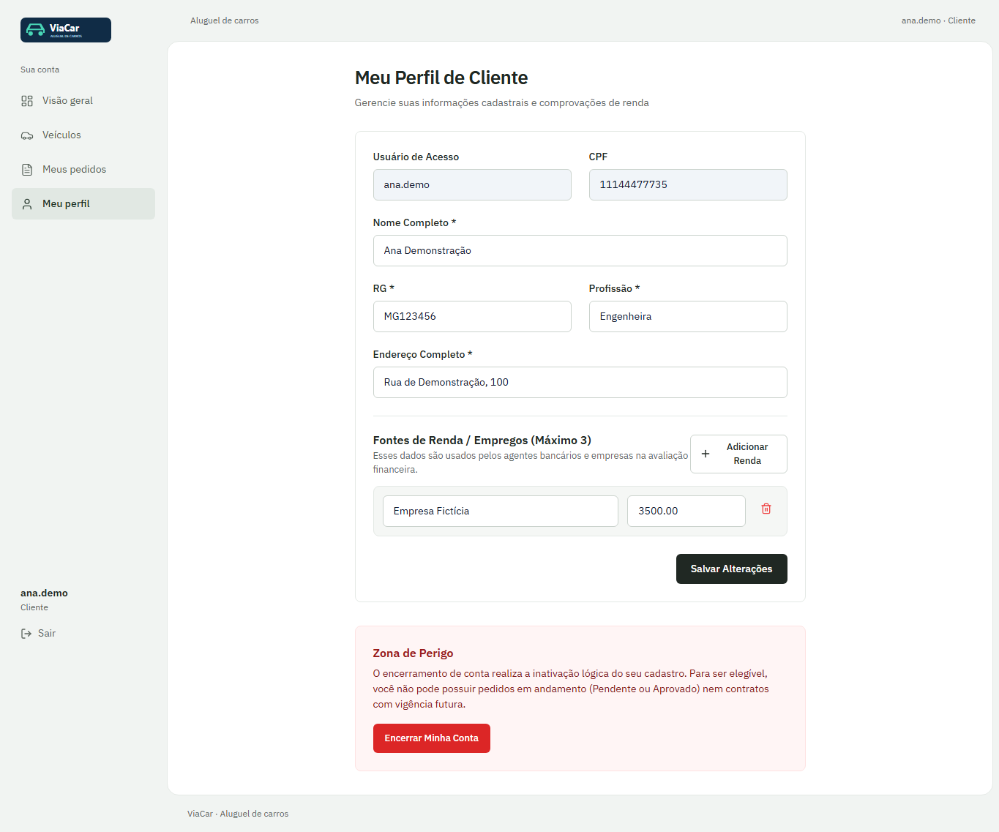

# ViaCar — Sistema de Aluguel de Carros


Projeto desenvolvido para o Laboratório 02 da disciplina Desenvolvimento e Integração de Aplicações Web (Engenharia de Software).
Sistema web para apoio à gestão de aluguéis de veículos, contemplando solicitação, análise financeira, concessão de crédito e emissão de contratos.

---

## Contas para teste

O banco já está configurado com contas prontas para avaliação de cada perfil do sistema:

| Papel | Usuário | Senha | Principais ações |
| :--- | :--- | :--- | :--- |
| **Cliente** | `cliente` | `123` | Escolhe automóveis no catálogo, cria pedidos, edita dados/rendas e acompanha contratos. |
| **Empresa** | `empresa` | `123` | Gerencia a frota (cadastra carros com fotos e diárias), avalia pedidos e emite contratos. |
| **Banco** | `banco` | `123` | Realiza avaliação financeira de pedidos e oferece propostas de crédito/financiamento. |

> Também é possível criar uma nova conta de cliente a qualquer momento pela tela de **Cadastro**.

---

## Como funciona

* **Cliente:** Cadastra-se com dados pessoais (RG, CPF, endereço, profissão e até 3 fontes de renda), escolhe um carro no catálogo e solicita o aluguel para um período determinado.
* **Agentes (Empresas e Bancos):** Recebem os pedidos pendentes, analisam as informações financeiras e emitem parecer de aprovação ou reprovação com justificativa.
* **Crédito Bancário:** Bancos podem propor ofertas de crédito vinculadas ao pedido aprovado.
* **Contratação:** Após aprovação, a empresa ou banco proprietário emite o contrato formalizando a locação ou a transferência do veículo.

---

## Tecnologias

* **Backend:** Java 25, Spring Boot 4.0.9 (Spring MVC, Spring Security, Spring Data JPA, Flyway).
* **Frontend:** React 19, TypeScript, Vite 8, Lucide React.
* **Banco de Dados:** PostgreSQL hospedado no Supabase.
* **Testes:** JUnit 5, Vitest e Playwright (testes E2E de navegador).

---

## Como executar o projeto

### Pré-requisitos
* **JDK 25** instalado.
* **Node.js** (versão 22.12+) e **npm**.

### 1. Iniciar o Backend

Abra um terminal na pasta do projeto:

```powershell
cd backend
.\mvnw.cmd spring-boot:run
```

A API iniciará em `http://localhost:8080`. As migrações do banco (Flyway V1, V2 e V3) são aplicadas automaticamente no schema `viacar`.

> As credenciais de conexão ao Supabase ficam configuradas localmente em `backend/.env`.

### 2. Iniciar o Frontend

Abra outro terminal na pasta do projeto:

```powershell
cd frontend
npm ci
npm run dev
```

Acesse a interface no navegador: **`http://localhost:5173`**.

---

## Telas do Sistema

| Catálogo de Veículos | Cadastro com Foto e Diária |
| :---: | :---: |
|  |  |

| Solicitação de Pedido | Análise Financeira e Crédito |
| :---: | :---: |
|  |  |

| Contrato Emitido | Perfil do Cliente |
| :---: | :---: |
|  |  |

---

## Testes Automatizados

### Backend (Testes Unitários e Integração)
```powershell
cd backend
.\mvnw.cmd test
```

### Frontend (Testes Unitários e Interface)
```powershell
cd frontend
npm test
npm run build
```

### Testes End-to-End (Playwright)
```powershell
cd frontend
npx playwright install chromium
npm run test:e2e
```

---

## Estrutura e Documentação

```text
backend/     API REST em Spring Boot, regras de negócio e migrações Flyway
frontend/    Interface web em React, componentes, catálogo e formulários
docs/        Documentação de requisitos, modelo de dados e diagramas UML
```

* [Requisitos e Regras de Negócio](docs/requisitos.md)
* [Histórias de Usuário](docs/historias.md)
* [Diagramas UML (Casos de Uso, Classes, Pacotes, Sequência)](docs/uml/README.md)
* [Modelo de Dados](docs/modelo-de-dados.md)
* [Documentação da API](docs/api.md)

---

## Participante

* **Keven Lino** ([@Tuzfi](https://github.com/Tuzfi))
