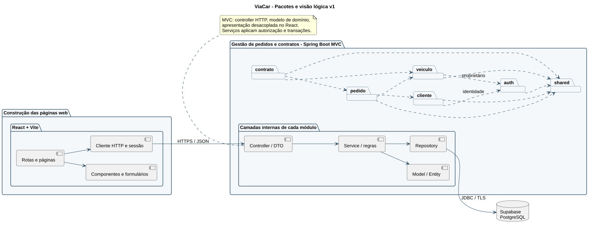

# ViaCar | Sistema de Aluguel de Carros


Projeto acadêmico do Laboratório 02 de Desenvolvimento e Integração de Aplicações Web.
A proposta é reunir clientes, empresas e bancos em um fluxo de pedidos de aluguel,
análise financeira e contratos pela Internet.

## Status

**Etapa 1 de 3: projeto e modelagem concluídos para revisão.** Ainda não existe aplicação
executável. As funcionalidades abaixo são escopo planejado, não funcionalidades entregues.
O desenvolvimento das etapas 2 e 3 depende da revisão do commit anterior pelo solicitante.

## Índice

- [Sobre o projeto](#sobre-o-projeto)
- [Funcionalidades planejadas](#funcionalidades-planejadas)
- [Tecnologias](#tecnologias)
- [Arquitetura e modelos](#arquitetura-e-modelos)
- [Instalação e execução](#instalação-e-execução)
- [Estrutura](#estrutura)
- [Demonstração e testes](#demonstração-e-testes)
- [Autores e referências](#autores-e-referências)

## Sobre o projeto

Clientes cadastrados poderão solicitar um automóvel, consultar o andamento, modificar ou
cancelar pedidos elegíveis. Agentes avaliarão pedidos financeiramente e prepararão contratos.
O sistema registrará os dados pessoais e até três vínculos de emprego/renda por cliente,
os automóveis, seus proprietários e o crédito opcional concedido por um banco agente.

## Funcionalidades planejadas

- Cadastro, login, logout e acesso conforme o perfil.
- Cadastro, consulta, edição e exclusão lógica do próprio perfil de cliente.
- Catálogo de automóveis e gestão da frota própria pelos agentes.
- Pedidos de aluguel com histórico e controle de alterações concorrentes.
- Análise financeira com parecer e justificativa.
- Contratos associados a pedidos aprovados e crédito bancário opcional.
- Telas responsivas com erros de validação e estados vazios/carregamento.

## Tecnologias

| Camada | Tecnologia planejada | Motivo |
| --- | --- | --- |
| Back-end | Java JDK 25 e Spring Boot 4.0.x | Exigência do enunciado |
| Build | Apache Maven com Wrapper | Exigência; execução reproduzível |
| Web/API | Spring MVC, Validation e Security | MVC, validação e autenticação |
| Persistência | Spring Data JPA, Flyway | Persistência e migrações versionadas |
| Banco | Supabase PostgreSQL | Exigência do enunciado |
| Front-end | React, TypeScript e Vite | React + Vite exigidos; tipagem escolhida |
| Testes | JUnit, Spring Test, PostgreSQL de teste; Vitest e Playwright | Regras, integração e jornadas |
| Modelagem | PlantUML, fontes e SVG versionados | UML revisável e imagens locais |

As versões exatas de bibliotecas serão fixadas nos manifests e lockfiles das etapas de
implementação. O uso de TypeScript, Flyway e das ferramentas de teste é uma decisão de projeto.

## Arquitetura e modelos

Monólito modular MVC com API JSON e interface React. O navegador conversa apenas com a API;
o back-end concentra autorização e regras de negócio e acessa o PostgreSQL.

- [Plano em três commits](docs/plano-de-entrega.md)
- [Requisitos e decisões](docs/requisitos.md)
- [Histórias e critérios de aceite](docs/historias.md)
- [Arquitetura](docs/arquitetura.md)
- [Modelo de dados](docs/modelo-de-dados.md)
- [Contrato da API](docs/api.md)
- [Fluxos de telas](docs/interface.md)
- [Modelos UML e versões](docs/uml/README.md)
- [Plano de testes e rastreabilidade](docs/testes.md)
- [Checklist de revisão do commit 1](docs/revisao-commit-1.md)



## Instalação e execução

**Este commit contém documentação, não executáveis.** Não é necessário instalar dependências
para revisar os arquivos Markdown e SVG. Abra o README em um visualizador Markdown.

Para implementar/executar posteriormente: JDK 25, Node.js compatível com a versão de Vite
escolhida, Maven Wrapper e um projeto Supabase com PostgreSQL. Docker será opcional para
testes locais com PostgreSQL. A configuração planejada está em [ambiente](docs/ambiente.md).
Os comandos reais de instalação, build e execução serão adicionados após serem testados.

### Deploy

Não há ambiente publicado nem repositório remoto configurado. A entrega local não publica
dados, cria contas ou envia código ao GitHub. A publicação acadêmica será uma etapa de entrega
quando houver destino e autorização, sem inventar links de demonstração ou badges de CI.

## Estrutura

```text
README.md
CONTRIBUTING.md
docs/
  plano-de-entrega.md
  requisitos.md
  historias.md
  arquitetura.md
  modelo-de-dados.md
  api.md
  interface.md
  ambiente.md
  testes.md
  revisao-commit-1.md
  assets/logo.svg
  uml/README.md
  uml/v1/*.puml, *.svg
```

`backend/`, `frontend/` e as migrações serão criados nos commits correspondentes.

## Demonstração e testes

A demonstração funcional será entregue no commit 3. Os fluxos de interface são especificados
em [interface](docs/interface.md); não são capturas de uma aplicação existente.

Nesta etapa, a verificação abrange integridade dos links locais, geração dos diagramas,
cobertura dos requisitos e consistência da modelagem. Nenhum teste funcional da aplicação
foi executado, pois o código ainda não foi implementado. Consulte o [plano de testes](docs/testes.md).

## Autores e referências

Os dados dos integrantes da equipe acadêmica serão informados pelo responsável antes da entrega.
Este planejamento foi preparado com auxílio do Codex e deve ser revisado pela equipe.

- Enunciado fornecido: DIAW, Laboratório 02, Sistema de Aluguel de Carros, 3 páginas.
- Modelo de README fornecido, atribuído ao Prof. Dr. João Paulo Carneiro Aramuni;
  seções adaptadas ao escopo e ao estágio real do projeto.
- [Referência de uso do PlantUML](https://plantuml.com/starting), utilizada para gerar os diagramas.

## Contribuição

Consulte [CONTRIBUTING.md](CONTRIBUTING.md). Alterações no modelo e no código devem manter
os requisitos e diagramas alinhados. A revisão ocorre ao final de cada um dos três commits.

## Licença

Licença de distribuição a definir pelo responsável. O exemplo MIT do template não foi
adotado automaticamente. Os materiais acadêmicos de referência mantêm sua autoria original.
