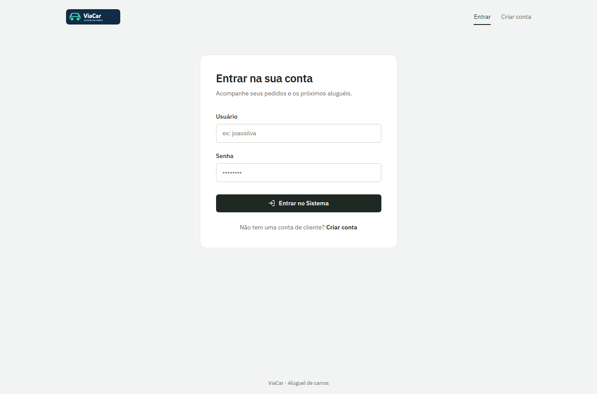
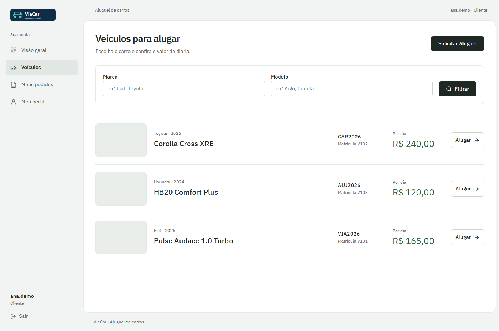
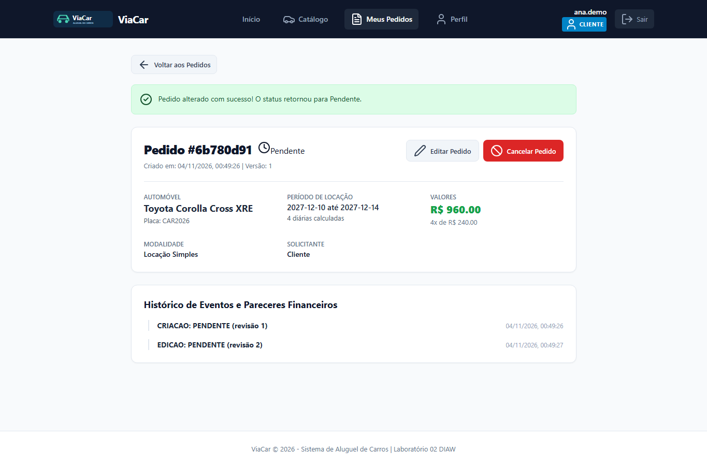
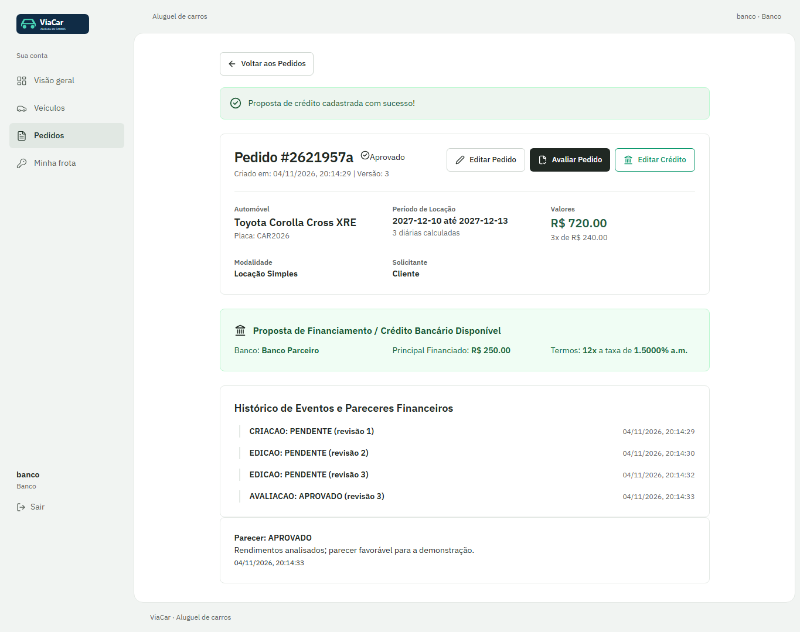
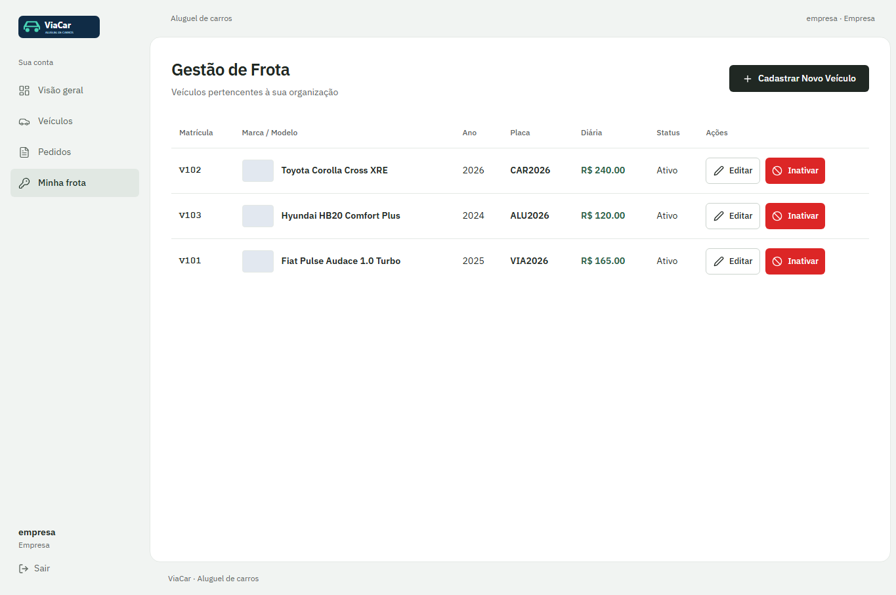
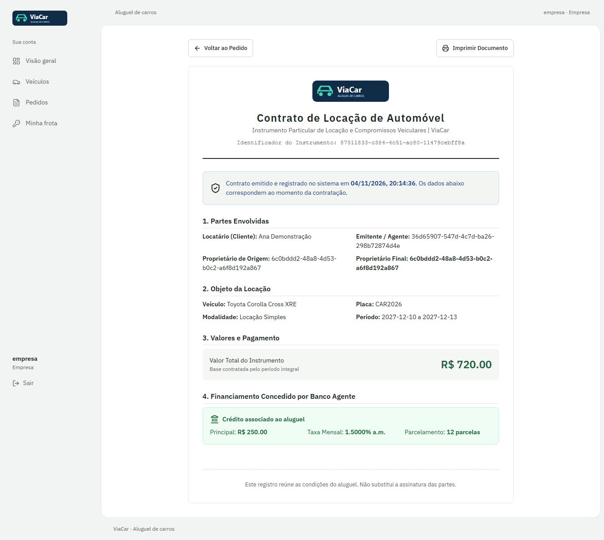

# ViaCar | Sistema de Aluguel de Carros


Protótipo acadêmico do Laboratório 02 de Desenvolvimento e Integração de Aplicações Web.
Clientes solicitam aluguéis; empresas e bancos avaliam os pedidos e a locadora proprietária
emite contratos com crédito bancário opcional.

## Status

Entrega final local: API, interface integrada, documentação e capturas reais. A verificação
está registrada em [revisão final](docs/revisao-commit-3.md). A conexão remota ao Supabase
permanece **pendente de credenciais e homologação**; os testes usam PostgreSQL real temporário.

Repositório: [Tuzfi/sistema-aluguel-carros](https://github.com/Tuzfi/sistema-aluguel-carros) (privado).

## Índice

- [Funcionalidades](#funcionalidades)
- [Tecnologias e arquitetura](#tecnologias-e-arquitetura)
- [Instalação e execução](#instalação-e-execução)
- [Demonstração](#demonstração)
- [Testes](#testes)
- [Documentação](#documentação)
- [Participante](#participante)
- [Licença](#licença)

## Funcionalidades

- Cadastro de clientes, login por usuário/senha, sessão, CSRF e logout.
- Perfil com RG, CPF, nome, endereço, profissão e até três empregos/rendas.
- Catálogo de carros e cadastro, edição e inativação da frota do próprio agente.
- Criação, consulta, edição e cancelamento de pedidos, com histórico e controle de versão.
- Avaliação financeira por empresas e bancos, com justificativa e parecer preservados.
- Oferta e edição de crédito pelo banco concedente, sem operação financeira real.
- Contratos com termos imutáveis, sem sobreposição de períodos e com transferência opcional.
- Autorização no servidor: isolamento de clientes, conta inativa e papéis de agentes.

## Tecnologias e arquitetura

| Camada | Implementação |
| --- | --- |
| Back-end | Java 25, Spring Boot 4.0.9, Spring MVC, Security, Validation e Data JPA |
| Banco | PostgreSQL; configuração JDBC para Supabase; Flyway V1 e V2 |
| Build | Maven Wrapper 3.9.11 |
| Front-end | React 19, TypeScript, Vite 8 e React Router |
| Testes | JUnit, HTTP + PostgreSQL embarcado, Vitest e Playwright/Chromium |
| Modelos | Casos de uso, classes, pacotes, estados e sequência em PlantUML e SVG |

Monólito modular MVC: controllers recebem DTOs, serviços aplicam regras e transações,
repositórios persistem os modelos e o React constrói a apresentação. O navegador acessa
somente a API. Senhas do banco ficam no servidor.


```text
backend/       API Java, Maven Wrapper, migrações e testes de integração
frontend/      React, cliente HTTP, páginas, testes unitários e E2E
docs/          requisitos, histórias, arquitetura, UML e screenshots
docker-compose.yml   PostgreSQL local opcional
```

## Instalação e execução

Pré-requisitos: **JDK 25, Node.js 22.12+ e npm**. O Maven Wrapper baixa o Maven no primeiro
uso. Docker é opcional para o PostgreSQL persistente. Comandos abaixo para PowerShell,
executados a partir da raiz do repositório.

### Demonstração local sem Docker

Terminal 1:

```powershell
cd frontend
npm ci
$env:VIACAR_DEMO_PASSWORD = 'EscolhaUmaSenhaLocal123!'
npm run demo:api
```

Esse comando compila a aplicação, inicia PostgreSQL temporário e cria agentes fictícios
`empresa` e `banco`, com a senha escolhida acima, além de três automóveis. Use apenas para
demonstração local: o banco é temporário e não contém dados de produção. A API escuta
em `http://localhost:8080`; os clientes se cadastram na interface.

Terminal 2:

```powershell
cd frontend
npm run dev
```

Abra `http://localhost:5173`. Encerre a demonstração com Ctrl+C nos dois terminais.

### PostgreSQL persistente local

```powershell
docker compose up -d
cd backend
.\mvnw.cmd spring-boot:run '-Dspring-boot.run.profiles=local'
```

O perfil `local` usa o banco do Compose na porta 5432. O Compose inicia apenas o banco;
execute a interface em outro terminal. Não há agentes com senha fixa nas migrações.

### Supabase

Defina as variáveis **no processo**, usando os dados de conexão do seu projeto:

```powershell
$env:DB_URL = 'jdbc:postgresql://HOST:5432/postgres?sslmode=require'
$env:DB_USERNAME = 'USUARIO_DO_PROJETO'
$env:DB_PASSWORD = 'SENHA_DO_PROJETO'
# Somente para desenvolvimento HTTP local; em HTTPS mantenha true.
$env:APP_COOKIE_SECURE = 'false'
cd backend
.\mvnw.cmd spring-boot:run
```

`.env` não é carregado automaticamente. Consulte [ambiente](docs/ambiente.md).
O Flyway cria o schema `viacar`; use uma conexão com suporte a JDBC/transações e permissão
para migração. A aplicação não usa Supabase Auth nem expõe o banco ao navegador.
O ambiente remoto não foi testado porque não foram fornecidas credenciais.

### Provisionar agentes no banco escolhido

No mesmo ambiente de variáveis do banco, em um terminal interativo:

```powershell
cd backend
.\mvnw.cmd test-compile dependency:build-classpath '-Dmdep.outputFile=target/classpath.txt'
$cp = 'target/classes;' + (Get-Content target/classpath.txt -Raw).Trim()
java -cp $cp br.edu.viacar.auth.ProvisionarAgente
```

O comando solicita usuário, papel EMPRESA/BANCO, razão social, documento e senha oculta.
Cadastro público cria somente clientes. Não passe senha como argumento da linha de comando.

### Build

```powershell
cd backend
.\mvnw.cmd package
# Saída: backend/target/viacar-0.2.0.jar
cd ../frontend
npm run build
# Saída: frontend/dist/
```

Em produção, sirva `dist` com fallback de SPA e encaminhe `/api` para a API na mesma
origem HTTPS, usando cookies Secure. `vite preview` não configura esse proxy de produção.
Não há deploy público nesta entrega.

## Demonstração

Capturas da aplicação real em navegador Chromium, usando somente dados fictícios.

| Login | Catálogo |
| --- | --- |
|  |  |

| Pedido e histórico | Avaliação e crédito |
| --- | --- |
|  |  |

| Frota da empresa | Contrato emitido |
| --- | --- |
|  |  |

[Perfil do cliente](docs/screenshots/07-perfil.png) · [Versão mobile](docs/screenshots/08-mobile.png)

## Testes

```powershell
cd backend
.\mvnw.cmd test
cd ../frontend
npm ci
npm test
npm run build
npm run lint
npx playwright install chromium
npm run test:e2e
```

O E2E inicia sua própria API, PostgreSQL temporário e Vite nas portas 18080 e 15173,
sem reutilizar servidores de desenvolvimento. Exercita cadastro, login, CSRF, pedido,
edição por cliente/agente, parecer, crédito, emissão, perfil, cancelamento e exclusão lógica.
As capturas acima são regeneradas pelo teste. [Resultados e limites](docs/revisao-commit-3.md).

## Documentação

- [Requisitos e decisões de domínio](docs/requisitos.md)
- [Histórias e critérios de aceite](docs/historias.md)
- [Arquitetura MVC](docs/arquitetura.md)
- [Modelo de dados](docs/modelo-de-dados.md)
- [Contrato da API](docs/api.md); OpenAPI autenticado em `/api/openapi`
- [Interface](docs/interface.md)
- [Modelos UML versionados](docs/uml/README.md)
- [Plano de testes](docs/testes.md)
- [Ambiente](docs/ambiente.md)
- [Revisão final](docs/revisao-commit-3.md)
- [Roteiro de apresentação](docs/roteiro-apresentacao.md)
- [Contribuição](CONTRIBUTING.md)

## Participante

[Keven Lino](https://github.com/Tuzfi)

## Licença

Licença de distribuição a definir; não foi adotada automaticamente a licença do template.

Referências fornecidas: enunciado DIAW Laboratório 02, Sistema de Aluguel de Carros, e
template de README atribuído ao Prof. Dr. João Paulo Carneiro Aramuni. Modelagem gerada
com [PlantUML](https://plantuml.com/starting).
