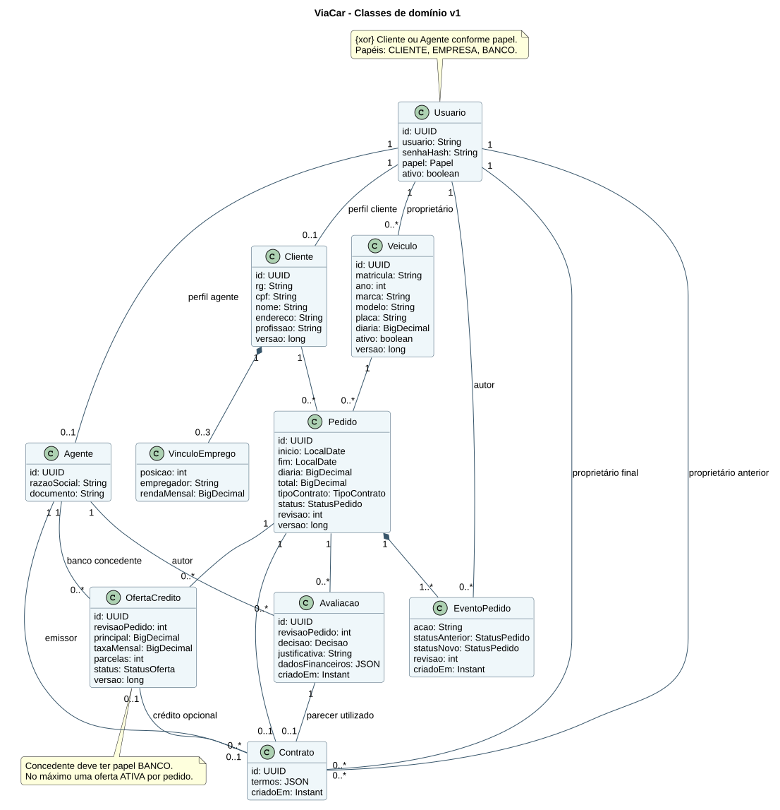
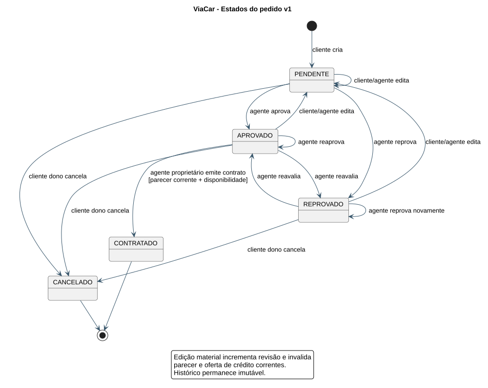
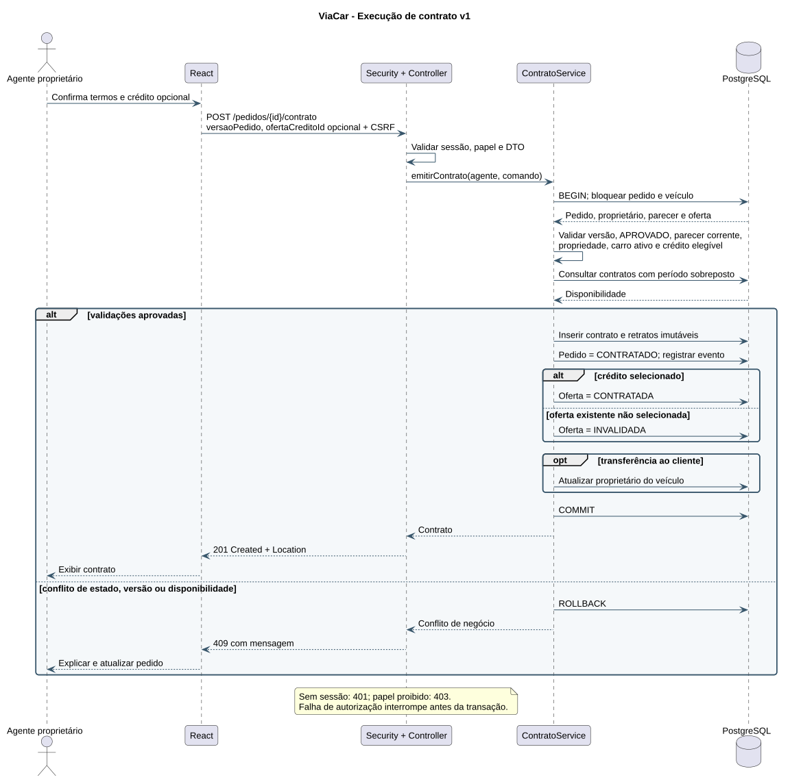

# Modelos UML versionados

Versão inicial **v1**, de 03/11/2026, anterior à implementação. Os arquivos `.puml` são a
fonte editável; os `.svg` são imagens geradas localmente pelo PlantUML. Não há dependência
de renderização externa para visualizar as imagens.

| Modelo | Fonte | Imagem |
| --- | --- | --- |
| Casos de uso | [puml](v1/casos-uso.puml) | [SVG](v1/casos-uso.svg) |
| Classes de domínio | [puml](v1/classes.puml) | [SVG](v1/classes.svg) |
| Pacotes / visão lógica | [puml](v1/pacotes.puml) | [SVG](v1/pacotes.svg) |
| Estados do pedido | [puml](v1/estados-pedido.puml) | [SVG](v1/estados-pedido.svg) |
| Sequência da contratação | [puml](v1/sequencia-contrato.puml) | [SVG](v1/sequencia-contrato.svg) |

## Casos de uso


## Classes



## Estados



## Sequência



## Histórico e regeneração

| Versão | Situação | Alterações |
| --- | --- | --- |
| v1 | Inicial, para revisão | Domínio, atores, módulos e fluxo contratual planejados |

Em C2/C3, criar v2/v3 quando houver mudança semântica e registrar motivo, impacto e
diferença entre modelo inicial e código. Não sobrescrever a base aprovada.

Renderizador usado: PlantUML 1.2026.8. Com o JAR obtido da distribuição oficial, a partir
da raiz do projeto:

```powershell
java -jar <caminho-do-plantuml.jar> -charset UTF-8 -tsvg docs/uml/v1/*.puml
```

O JAR é ferramenta de desenvolvimento e não está incorporado ao repositório.
Referências: [guia oficial](https://plantuml.com/starting) e
[release utilizada](https://github.com/plantuml/plantuml/releases/tag/v1.2026.8).
