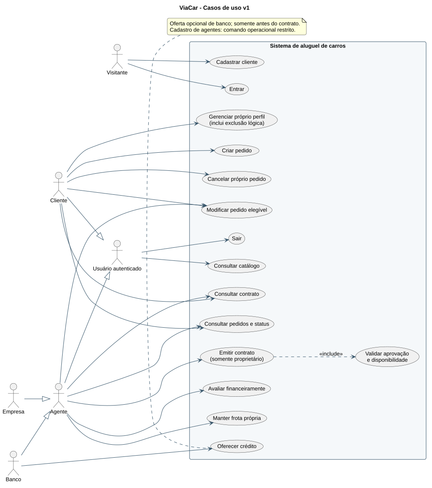
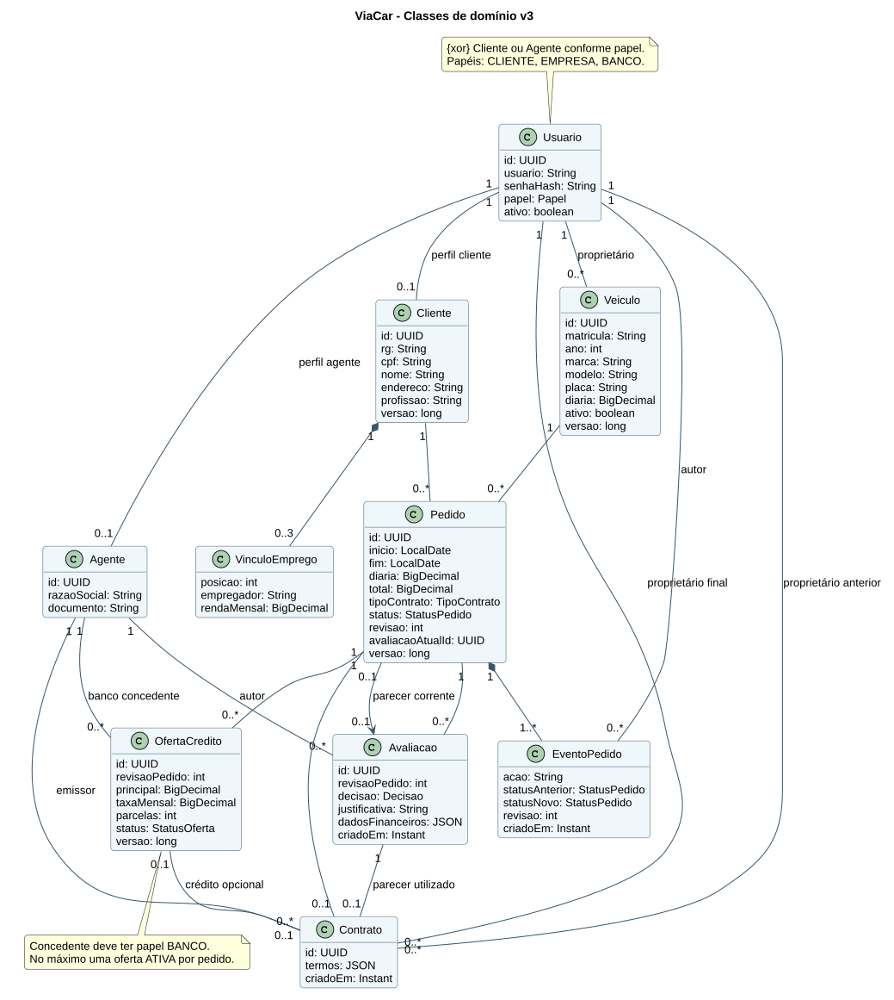
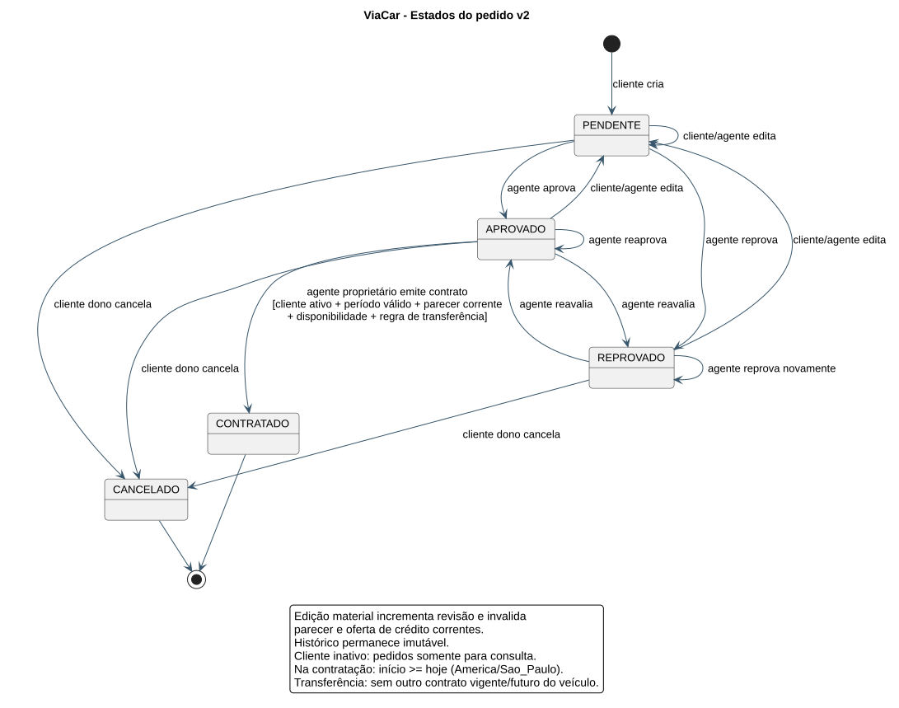
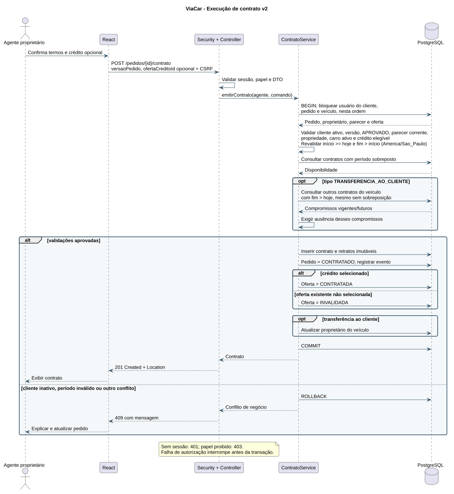

# Modelos UML versionados

Modelos iniciais preservados e revisão final v3 de 04/11/2026. A revisão **v2**, de 03/11/2026, atualiza estados
e contratação; casos de uso e pacotes permanecem na v1; classes passam à v3. Os arquivos `.puml` são a
fonte editável; os `.svg` são imagens geradas localmente pelo PlantUML. Não há dependência
de renderização externa para visualizar as imagens.

| Modelo | Fonte | Imagem |
| --- | --- | --- |
| Casos de uso | [puml](v1/casos-uso.puml) | [SVG](v1/casos-uso.svg) |
| Classes de domínio | [puml](v3/classes.puml) | [SVG](v3/classes.svg) |
| Pacotes / visão lógica | [puml](v1/pacotes.puml) | [SVG](v1/pacotes.svg) |
| Estados do pedido | [puml](v2/estados-pedido.puml) | [SVG](v2/estados-pedido.svg) |
| Sequência da contratação | [puml](v2/sequencia-contrato.puml) | [SVG](v2/sequencia-contrato.svg) |

## Casos de uso



## Classes



## Estados



## Sequência



## Histórico e regeneração

| Versão | Situação | Alterações |
| --- | --- | --- |
| v1 | Base preservada | Domínio, atores, módulos e fluxo contratual planejados |
| v3 | Implementação final | Referência explícita do pedido ao parecer corrente; relações persistidas por UUID e FKs |
| v2 | Revisão das regras | Cliente inativo, período vencido e compromissos que impedem transferência; estados e sequência atualizados |

Nas próximas etapas, criar nova versão quando houver mudança semântica e registrar motivo, impacto e
diferença entre modelo inicial e código. Não sobrescrever a base aprovada.

Renderizador usado: PlantUML 1.2026.8. Com o JAR obtido da distribuição oficial, a partir
da raiz do projeto:

```powershell
java -jar <caminho-do-plantuml.jar> -charset UTF-8 -tsvg docs/uml/v1/*.puml
java -jar <caminho-do-plantuml.jar> -charset UTF-8 -tsvg docs/uml/v2/*.puml
```

O JAR é ferramenta de desenvolvimento e não está incorporado ao repositório.
Referências: [guia oficial](https://plantuml.com/starting) e
[release utilizada](https://github.com/plantuml/plantuml/releases/tag/v1.2026.8).
